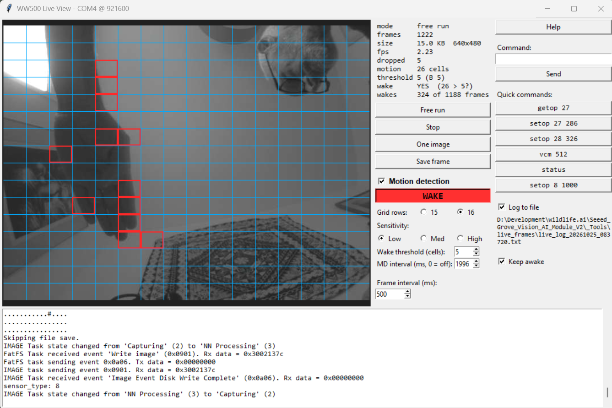

# Explore motion detection enhancemnts

#### File: `README.md`
#### Path: `_Documentation\development reports\2026-10-23_mdEnhancements\README.md`
#### Author: Charles Palmer
#### Date: 23 October 2026

## Background

The HM0360 has motion detection (MD) capabilities that are used at present. 
There are many MD regsiters in the HM0360 and some of these are available to the user through
Operational Parameters. It is possible if other regsiter settings were available to the user through
new Operational Parameters, then the user might be able to get finer adjustments of MD behaviour.

I don't have a view of the MD enhancements yet, but changing the threshold required to issue a MD interrupt would be 
one.

## Live View

There is a live preview facility documeted in the PR #140 documents 
(Live preview over the console UART (preview.c, _Tools/live_view.py))

At the time of writing I have not had this working. I want to get it running. I can see the pythin script runs on 
my machine, and what I assume is jpeg data being sent, but the image view area on my laptop stays black.
We should get that going.

I would like this feature to be documented.

Since the live view work was doen we have also done work to increase the speed of JPEG file transfers to the 
app via BLE. The live view uses the UART rather than BLE, but possibly there are some lessons that could be
transferred to the live view transfer.

## Adding MD grid on the live view screen

The HM0360 reports which of the 16 x 16 array of cells has MD chnages. It should be possibe to superimpose a
grid onto the image, so that the cells that have chnaged could be viewed.

This python script culd also have buttons, sliders etc that allowed some MD values to be changed by the user
dynamically. The script should be based on the live view work.

---

## Task for Claude

1.	Read this document and any dpcumentation that you can find concerning the live view facility.
2.	Look at code where relevant.
3.	Create a markdown document that proposes dealing with issues raised above in a series of 
steps that we can carry out one at a time. Place it in the same folder as this document.
4.	Don't write any code until after we have both reviewed that proposal document.

---

## Status

Closed, 25 October 2026. The work is in [PR #276, Motion Detection enhancements](https://github.com/wildlifeai/Seeed_Grove_Vision_AI_Module_V2/pull/276).

## Outcome

**Live view works on both builds** (HM0360 and RP3). The black image area had two causes:

1. **Every frame was corrupted.** The IF task's console prints landed inside each frame line.
   Fixed in firmware: the IF task stays quiet while a frame is sent (`preview_isSending()`).
2. **The viewer predated the 13 October cold-boot capture refusal**, and its typing kept the
   device awake. Fixed in `live_view.py`: it tells cold and warm boots apart, and `--wake N`
   sets a timelapse wake so streaming starts by itself.

**The viewer is now an MD tuning tool.** With Motion detection on it shows the HM0360 motion
grid over the image and a WAKE lamp that lights when a frame would wake the device, and it
sets Sensitivity (op 17), Wake threshold (op 33) and MD interval (op 11).

**MD settings became op parameters.** Op 33 is the MD wake threshold: the device wakes when
more than this many cells show motion (1-255, default 4). Op 17 is now 1 to 3 only; op 11 = 0
is the one way to switch MD off. Invalid values are refused by `setop` and replaced when
CONFIG.TXT loads. A new `interval` command changes the frame interval mid-burst. Changes the
BLE processor, app and website need: [cross_repo_changes.md](cross_repo_changes.md).

**Decided:** step 3 (speed) closed, about 2 fps is enough; no `mdreg` or per-register
sliders; MD does not miss slow movement (it only seemed to at a 20 ms interval, when most
frames were never displayed); the INT_INDIC per-frame clear left unexplained, since the field
wake works.

The viewer on the HM0360 build, 25 October 2026: the cells that saw motion in red, and the WAKE
lamp lit because 26 cells is more than the wake threshold of 5.

Details: [CLAUDE_mdEnhancements_proposal.md](CLAUDE_mdEnhancements_proposal.md). Durable docs:
[live_preview.md](../../live_preview.md), [config_file.md](../../../EPII_CM55M_APP_S/app/ww_projects/ww500_md/MANIFEST/config_file.md)
(ops 11, 17, 33), [ble_commands.md](../../ble_commands.md) (`AI interval`).

## Open items

None in this repo.

## Files

| File | What it is |
|---|---|
| [CLAUDE_mdEnhancements_proposal.md](CLAUDE_mdEnhancements_proposal.md) | Stepped plan, with the bench findings and decisions from 23 to 25 Oct |
| [cross_repo_changes.md](cross_repo_changes.md) | Running list of changes the BLE processor and app need to know about, for the PR |
| [live_view_hm0360_md.png](live_view_hm0360_md.png) | The viewer on the HM0360 build with Motion detection on, 25 Oct |
